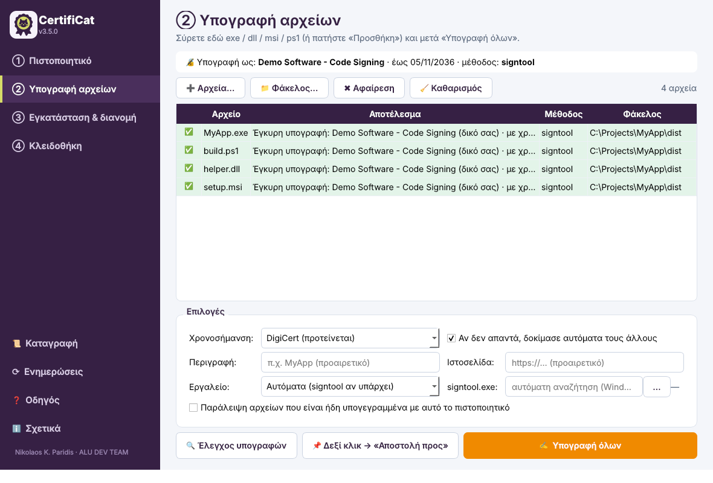
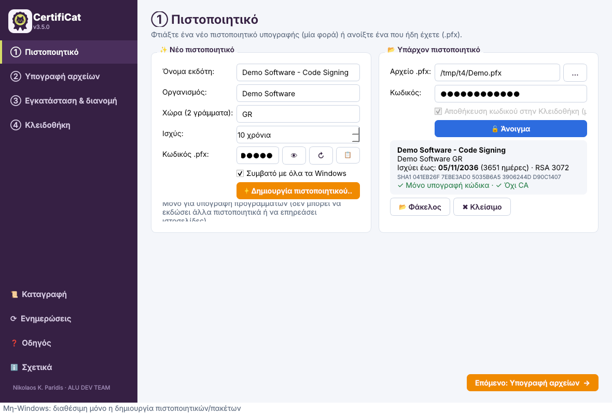
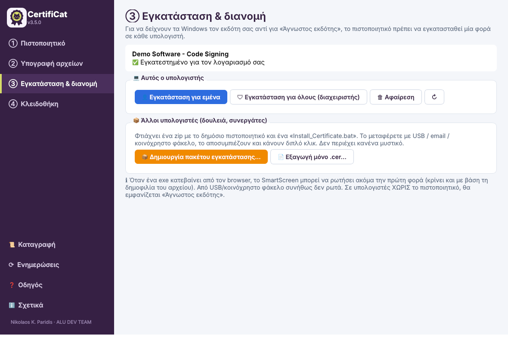
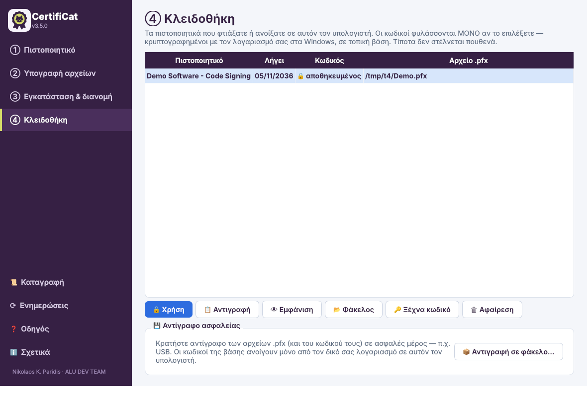
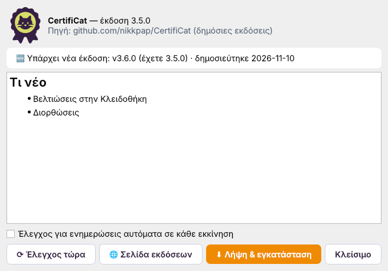

# CertifiCat 🐱


**Self-signed code-signing certificates and one-click signing for your Windows apps.**
**Πιστοποιητικά υπογραφής κώδικα και υπογραφή των προγραμμάτων σας με ένα κλικ.**

Create a code-signing certificate, sign `.exe / .dll / .msi / .ps1 …`, install the certificate on your PC
and give colleagues a double-click installer, so Windows shows **your name** instead of “Unknown publisher”.

> Η εφαρμογή είναι στα ελληνικά. · The user interface is in Greek.



---

## ⬇️ Download

Get the latest **`CertifiCat_v*.pyw`** from **[Releases](https://github.com/nikkpap/CertifiCat/releases/latest)** and double-click it.

- **Windows 10 / 11** and **Python 3.9+** ([python.org](https://www.python.org/downloads/))
- On first launch the app **installs everything it needs by itself** (PyQt6, cryptography).
- `signtool.exe` is optional. If it's missing, the app signs with the PowerShell that comes with Windows.
  If you clone the repo, the bundled `tools\signtool.exe` is found automatically.
- After that the app **updates itself** from Releases (menu ⟳ *Ενημερώσεις*).

---

## 🧭 How it works — 3 steps

| | Step | What you do |
|---|---|---|
| ① | **Πιστοποιητικό** (Certificate) | Create a certificate once (`.pfx` private + `.cer` public + `_Certificate.zip` for other PCs), or open one you already have. |
| ② | **Υπογραφή** (Sign) | Drag & drop files or folders, then click **Υπογραφή όλων** (Sign all). Re-sign after every new build. |
| ③ | **Εγκατάσταση** (Install) | One click on this PC. Other PCs get the zip: unzip and double-click `Install_Certificate.bat`. |
| ④ | **Κλειδοθήκη** (Vault) | A list of all your certificates. If you choose to, it also keeps their passwords, encrypted on this PC. |

<p>
 
 
</p>

---

## ✨ Features

- **Safe certificates:** **Code Signing only** (EKU), `CA:FALSE`. They can't issue other certificates or affect HTTPS, even when installed in Trusted Root.
- **Batch signing** of `.exe .dll .msi .sys .ocx .cab .cat .ps1 .psm1 .psd1 .msix .appx .vbs .js`, including whole folders.
- **Timestamping (RFC 3161)** with automatic fallback: DigiCert → Sectigo → GlobalSign.
- **Verification** of every file after signing, plus **skip already-signed** files.
- **Right-click → Send to → CertifiCat** to sign straight from Explorer.
- **Command line** for build scripts: `pythonw CertifiCat_v3.5.pyw --sign dist\MyApp.exe`
- **Install for me / for all users** (a single UAC prompt), uninstall, and status check (Root + Trusted Publishers).
- **Installer package** (`.zip`) for other PCs: contains only the public `.cer` and a `.bat`.
- **Log** of every signtool / PowerShell message.
- **OTA updates** from public GitHub Releases.

---

## 🔒 Privacy & security

- **No secrets in the app.** No tokens, no API keys, no telemetry. The update check reads the public Releases API anonymously.
- **Your passwords never leave your PC.** They are saved **only if you choose to**, in a local database
  (`%APPDATA%\CertifiCat\certificat.db`), encrypted with **Windows DPAPI**, so only your Windows account on this PC can unlock them.
- During signing the password is passed to PowerShell through an environment variable, not on the command line,
  and the log masks it. Note: `signtool.exe` only accepts the password on its command line (`/p`),
  so pick “Εργαλείο: Πάντα PowerShell” if you want it hidden from the process list too.
- Updates are checked before install: they must be a valid CertifiCat file and match the optional `*.sha256`.
  For a compiled `.exe`, the new file must carry the **same digital signature** as the running one.

> ⚠️ A self-signed certificate is trusted only on PCs where you install your `.cer`. On other PCs Windows still shows “Unknown publisher”, and SmartScreen reputation is separate (it needs a CA-issued certificate).

---

## 📦 Publishing a release (maintainer)

1. Change `APP_VERSION` in the `.pyw` file, e.g. `3.6.0`.
2. Create a GitHub Release with tag **`v3.6.0`** and attach:
   - `CertifiCat_v3.6.pyw`
   - `CertifiCat_v3.6.pyw.sha256` (optional but recommended): `certutil -hashfile CertifiCat_v3.6.pyw SHA256`, or `sha256sum CertifiCat_v3.6.pyw > CertifiCat_v3.6.pyw.sha256`
   - optionally `CertifiCat.exe` (+ `.sha256`) for the compiled build. Sign it with CertifiCat itself.
3. Installed copies will find the update on their next start.

---

## 📁 Repository

```
CertifiCat_v3.5.pyw     ← the app (single file)
tools/                  ← signtool.exe & helpers (optional, auto-detected)
screenshots/v3.5/       ← screenshots
legacy/                 ← older Tkinter version (v2.5)
```

---

## 👤 Author

**Νικόλαος Κ. Παρίδης · Nikolaos K. Paridis**, Civil Engineer · ALU DEV TEAM
✉ [nikkpap@gmail.com](mailto:nikkpap@gmail.com) · [github.com/nikkpap](https://github.com/nikkpap)

Licensed under **GPL-3.0**, see [LICENSE](LICENSE).
